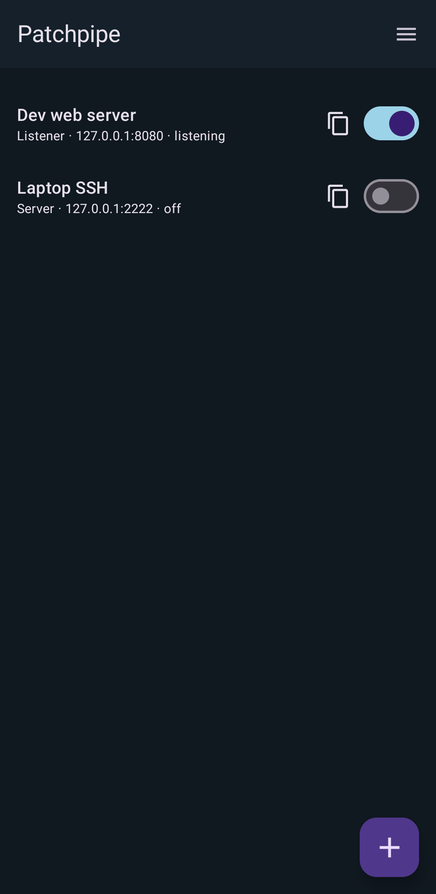

# Patchpipe

[](https://github.com/walterl/patchpipe/actions/workflows/ci.yml)

Access services running anywhere from your Android device, through end-to-end
encrypted, single socket channels. No firewall changes required.

Patchpipe is an Android app that runs [dumbpipe](https://dumbpipe.dev) TCP
forwarders on the device. Plug a local app into `127.0.0.1:<port>`; Patchpipe
routes the bytes over an iroh connection.

There is no Patchpipe cloud. Tickets, names, notes, and secret keys stay on the
device. Stream contents are end-to-end encrypted; relays see connection
metadata, not pipe names or notes.



## Modes

- **Server:** listen on `127.0.0.1:<port>` and dial the remote named in a
  ticket (`dumbpipe connect-tcp`).
- **Listener:** accept iroh connections and forward each stream to a local TCP
  service (`dumbpipe listen-tcp`).

Local TCP is bound to loopback only.

## Background operation

- Default iroh behaviour uses n0 production relays for NAT traversal, matching
  desktop dumbpipe 0.40. You can disable relays or set custom relay URLs per
  pipe.
- DNS uses the device resolver (iroh needs a JNI application context for that
  on Android). If that context is missing, lookups fall back to Quad9
  (`9.9.9.9`).
- Enabled pipes run in a foreground service with a notification showing each
  pipe's state, so they keep forwarding while the app is not on screen. When no
  pipe is running or waiting to retry, the service stops.
- Saving new connection settings (port, ticket, key, relays) restarts a running
  pipe. A pipe that fails to start is retried with backoff (2 s doubling to
  60 s) while it is enabled and **Auto-retry** is on.
- The engine watches the default network (Wi-Fi to cellular) and pokes every
  active pipe when it switches.
- **Start at boot** is opt-in and off by default; only then does a boot
  broadcast bring enabled pipes back up.
- The pipe list warns when battery optimization or disabled notifications would
  keep pipes from staying up (or hide their status) and links to the settings.

## Build

You need a user-local Rust toolchain, Android SDK + NDK r27, and Java 17+.
Nothing is installed system-wide.

```bash
# SDK (example paths used in this repo)
export ANDROID_HOME="$HOME/.local/share/android/sdk"
export ANDROID_NDK_HOME="$ANDROID_HOME/ndk/27.1.12297006"
export PATH="$HOME/.cargo/bin:$PATH"

rustup target add aarch64-linux-android x86_64-linux-android
cargo install cargo-ndk --locked

# Host tests for the forwarder
cargo test -p patchpipe-core

# UniFFI Kotlin bindings (from an unstripped debug .so)
./scripts/generate-bindings.sh

# APK
cp android/local.properties.example android/local.properties
# edit sdk.dir
cd android
./gradlew assembleDebug
```

The debug APK is `android/app/build/outputs/apk/debug/app-debug.apk`.

`./gradlew assembleDebug` also runs `cargo ndk` for `arm64-v8a` and `x86_64`.
The app runs on Android 8.0 and newer (`minSdk` 26).

## Privacy

- No analytics, crash reporting, or accounts.
- Pipe config is DataStore JSON in the app's private storage, including each
  pipe's secret key in plain text. Every pipe gets its own key: a relay keeps a
  single registration per endpoint id, so pipes sharing one key would drop each
  other.
- **Export** writes all pipes and app settings to a JSON file you choose.
  The file holds tickets and secret keys in plain text; keep it private.
  **Import** adds the pipes in such a file and replaces pipes with the same
  id. New pipes start switched off.
- Sharing a listener ticket uses the system share sheet (local). The ticket
  itself is how a peer finds you; do not post it publicly.

## F-Droid / reproducible builds

NDK version is pinned in Gradle (`27.1.12297006`). Generated Kotlin bindings
are committed. Native libraries are built from this tree, not downloaded.
Release `.so` files are stripped; generate bindings from a debug build.

## License

MIT OR Apache-2.0. TCP forwarding loops follow dumbpipe
(`n0-computer/dumbpipe`), same license.
